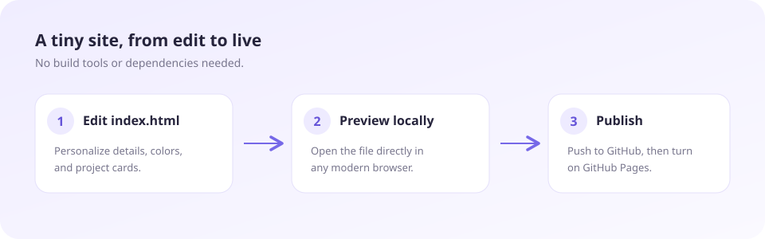

# Anto Jeries A — Portfolio

A responsive, single-page portfolio made with plain HTML, CSS, and JavaScript. The website itself is one self-contained `index.html`: no package manager, build step, framework, or server is required. The four project cards are illustrative concepts and can be replaced with Anto's real work.

## View locally

1. Download or clone this repository.
2. Open `index.html` in a browser.

The page uses the device's light/dark preference by default. Use the moon/sun button in the navigation to switch themes; the choice is remembered in that browser.

## Make it yours

- Update the name, study details, class year, email, and GitHub URL in `index.html`.
- Replace the example project names and descriptions with your own projects or GitHub repositories.
- Adjust the `--accent` color tokens near the top of the `<style>` block to change the theme.

## Publish with GitHub Pages

1. Push the repository to GitHub.
2. Open the repository's **Settings → Pages**.
3. Under **Build and deployment**, choose **Deploy from a branch**, select `main` and `/ (root)`, then save.
4. GitHub Pages will show the published URL in the Pages settings. A repository named `jeriesanto-prog.github.io` can use the profile-site URL; a regular repository uses a URL in the form `https://jeriesanto-prog.github.io/repository-name/`.

The portfolio is public when published. Its email address and any other contact details in `index.html` will be visible to visitors.
